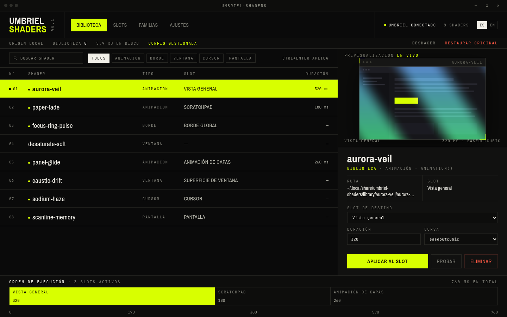

# Umbriel Shaders

A local shader library for Umbriel: browse your animations, preview them live and
apply them to effect slots without hand-editing `config.toml`.



Version 0.1.0 · Linux (Wayland and X11) · MIT · Tauri 2 (Rust + WebGL)

## What it does

- **Library** — downloads the official community catalogue, keeps it in sections
  (screen, borders, cursor, windows, animations) and previews the real shader in
  WebGL before applying it.
- **Slots** — every Umbriel destination in one grid, with its current shader.
  **Clear animation** / **Clear effect** empties a slot; **Undo** brings it back.
- **Families** — local groups by effect kind: apply one shader to every compatible
  destination at once.
- **Settings** — library folder, original Umbriel configuration, validation,
  language (ES/EN) and reduced motion.

The app never rewrites your whole `config.toml`. It finds the file that actually
carries the animations —`config.toml` itself or an included file such as
`src/animations.toml`— and rewrites only the keys of the animation you apply
(`enabled`, `effect`, `duration_ms`, `curve`). Comments, unrelated keys, presets and
every other file stay byte-identical. The result is validated with
`umbriel config validate` before success is reported; if Umbriel rejects it, the
change is reverted.

Umbriel watches the files it includes, so the change takes effect live without
`config-replace` or a restart. The edited path is shown in the message and in
Settings. **Undo** writes back the exact previous bytes; **Restore original** does
that for every change the app recorded.

## Requirements

- Linux with WebKitGTK 4.1 (`libwebkit2gtk41`) and GTK 3.
- `umbriel` on `PATH`, and a running Umbriel session for applying changes.
- WebGL for previews (WebKitGTK provides it).
- Network access the first time you download the community catalogue.

Building from source additionally needs Rust 1.77+ and the development headers
(`gtk+3-devel`, `libwebkit2gtk41-devel`, `libsoup3-devel`).

## Install

The recommended path on Void Linux, Arch, Debian/Ubuntu and derivatives is the
bundled installer, which builds when needed and installs the binary, icons and menu
entry under `~/.local` (no `sudo`):

```sh
git clone https://github.com/Evergaster/umbriel-shaders-app.git
cd umbriel-shaders-app
./install.sh
```

System-wide:

```sh
make build
sudo ./install.sh --prefix /usr/local
```

Or take the tarball from the [latest release](https://github.com/Evergaster/umbriel-shaders-app/releases/latest)
and run its installer, no compilation required:

```sh
curl -fLO https://github.com/Evergaster/umbriel-shaders-app/releases/download/v0.1.0/umbriel-shaders-0.1.0-x86_64-linux.tar.gz
curl -fLO https://github.com/Evergaster/umbriel-shaders-app/releases/download/v0.1.0/umbriel-shaders-0.1.0-x86_64-linux.tar.gz.sha256
sha256sum -c umbriel-shaders-0.1.0-x86_64-linux.tar.gz.sha256
tar -xzf umbriel-shaders-0.1.0-x86_64-linux.tar.gz
cd umbriel-shaders-0.1.0-x86_64-linux
./install.sh
```

Uninstall:

```sh
./install.sh --uninstall          # or: make uninstall
```

Per-distribution instructions, exact dependencies and troubleshooting:
[`docs/instalacion.md`](docs/instalacion.md) (Spanish).

## First run

1. Open **Umbriel Shaders** from the application menu (or run `umbriel-shaders`).
2. In **Library**, press **Install examples** for eight starter shaders, or
   **Download official catalogue** for the community collection.
3. Pick a shader: the right panel previews it live over a synthetic window.
4. Choose the destination **slot**, set **duration** and **curve**, then press
   **Apply to slot** (`Ctrl+Enter`).
5. Changed your mind: **Undo** in the top bar, or **Restore original** to roll back
   everything the app recorded.

Full UI walkthrough: [`docs/uso.md`](docs/uso.md) (Spanish).

## Data

| Path | Purpose |
|---|---|
| `~/.local/share/umbriel-shaders/library/` | Your `.glsl` shaders (default; configurable in Settings) |
| `~/.local/share/umbriel-shaders/catalogue.json` | Cached official catalogue metadata |
| `~/.local/share/umbriel-shaders/generated/` | Managed config, copied shaders, application rules |
| `~/.config/umbriel-shaders/settings.json` | App settings |
| `~/.config/umbriel-shaders/state.json` | Applied selections and undo history |
| `~/.config/umbriel/config.toml.umbriel-shaders.bak` | Pristine original, kept while permanent changes are on |

The library is plain files. Move it, back it up, or edit a shader in place and press
**Rescan**.

## Shader format

A shader is a GLSL fragment snippet with one entry function:

```glsl
vec4 animation(vec2 uv) {
    vec4 base = umbriel_sample(uv);
    return mix(base, vec4(1.0), umbriel_clamped_progress);
}
```

Entry functions: `animation`, `border`, `window`, `cursor`, `screen`. Uniforms and
helpers: `umbriel_sample`, `umbriel_progress`, `umbriel_clamped_progress`,
`umbriel_time`, `umbriel_direction`, `umbriel_pointer`, `umbriel_size`.

The app ships eight starter shaders in `src-tauri/starters/`; **Install examples**
copies them into the library when missing. Details:
[`docs/shaders.md`](docs/shaders.md) (Spanish).

## Preview

The preview runs the actual shader file as a WebGL fragment shader over a synthetic
window texture, with a moving pointer and a looping progress value. A shader that
fails to compile shows its error instead of a fake image: it is a faithful test of
the fragment, not a capture of the compositor.

## Development

```sh
make dev      # tauri dev
make build    # release binary at src-tauri/target/release/umbriel-shaders
make test     # cargo test
make run      # build and run
make serve    # UI in a browser with the mock backend (http://localhost:4173)
make package  # tarball + sha256 in dist/
```

The UI is embedded from `ui/` at compile time; `src-tauri/build.rs` tells cargo when
that folder changes, so a plain `cargo build` picks up interface edits.
Architecture, file layout and known traps: [`docs/desarrollo.md`](docs/desarrollo.md)
(Spanish).

## Documentation

- [`docs/instalacion.md`](docs/instalacion.md) — install, update, remove.
- [`docs/uso.md`](docs/uso.md) — the four views and shortcuts.
- [`docs/shaders.md`](docs/shaders.md) — writing shaders for Umbriel.
- [`docs/desarrollo.md`](docs/desarrollo.md) — architecture and contributing.
- [`DESIGN.md`](DESIGN.md) — visual system and design decisions.
- [`PRODUCT.md`](PRODUCT.md) — scope, principles and product context.

## Not in this version

- Per-application window rules.
- Coordinated families from the community catalogue (current families group local
  shaders by kind).
- Editing Umbriel presets: they are listed and can be applied, but not modified.

The catalogue is downloaded from `noctalia-dev/community-umbriel-shaders` at the
revision its own catalogue publishes, with a SHA-256 check per shader.

## Licence

MIT. Starter shaders are original and ship under the same licence. See
[`LICENSE`](LICENSE).
