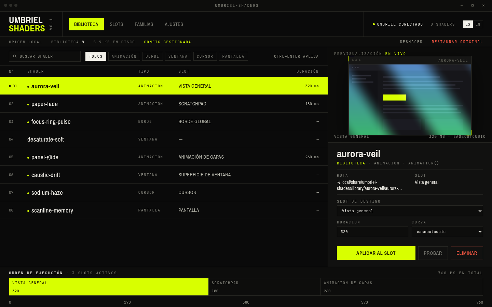

# Umbriel Shaders

Biblioteca local de shaders para Umbriel: explora tus animaciones, previsualízalas
en vivo y aplícalas a los slots de efectos sin editar `config.toml` a mano.



Versión 0.1.0 · Linux (Wayland y X11) · MIT · Tauri 2 (Rust + WebGL)

## Qué hace

- **Biblioteca** — descarga el catálogo oficial de la comunidad, lo guarda por
  secciones (pantalla, bordes, cursor, ventanas, animaciones) y previsualiza el
  shader real en WebGL antes de aplicarlo.
- **Slots** — todos los destinos de Umbriel en una rejilla, con el shader actual
  de cada uno. **Quitar animación** / **Quitar efecto** limpia un slot; **Deshacer**
  lo recupera.
- **Familias** — agrupaciones locales por tipo de efecto: aplica un shader a todos
  los destinos compatibles de una vez.
- **Ajustes** — carpeta de la biblioteca, configuración original de Umbriel,
  validación, idioma (ES/EN) y reducción de movimiento.

La app no reescribe tu `config.toml` entero. Localiza el archivo que define de
verdad las animaciones —`config.toml` o un incluido como `src/animations.toml`— y
cambia solo las claves de la animación que aplicas (`enabled`, `effect`,
`duration_ms`, `curve`). Comentarios, claves ajenas, presets y el resto de archivos
quedan idénticos byte a byte. Antes de dar el cambio por bueno se valida con
`umbriel config validate`; si Umbriel no lo acepta, se deshace solo.

Umbriel vigila los archivos que incluye, así que el cambio se ve en vivo, sin
`config-replace` ni reiniciar la sesión. La ruta editada aparece en el mensaje y en
Ajustes. **Deshacer** devuelve los bytes exactos anteriores; **Restaurar original**
lo hace para todos los cambios que la app registró.

## Requisitos

- Linux con WebKitGTK 4.1 (`libwebkit2gtk41`) y GTK 3.
- `umbriel` en el `PATH`, y una sesión de Umbriel en marcha para aplicar cambios.
- WebGL para las previsualizaciones (WebKitGTK lo trae).
- Conexión a red la primera vez que descargas el catálogo de la comunidad.

Para compilar además hacen falta Rust 1.77+ y las cabeceras de desarrollo
(`gtk+3-devel`, `libwebkit2gtk41-devel`, `libsoup3-devel`).

## Instalación

La forma recomendada en Void Linux, Arch, Debian/Ubuntu y derivados es el
instalador incluido, que compila si hace falta y deja binario, iconos y entrada de
menú en `~/.local` (sin `sudo`):

```sh
git clone https://github.com/Evergaster/umbriel-shaders-app.git
cd umbriel-shaders-app
./install.sh
```

Para instalarlo para todo el sistema:

```sh
make build
sudo ./install.sh --prefix /usr/local
```

También puedes bajar el tarball de la última release y ejecutar su instalador, sin
necesidad de compilar:

```sh
tar -xzf umbriel-shaders-0.1.0-x86_64-linux.tar.gz
cd umbriel-shaders-0.1.0-x86_64-linux
./install.sh
```

Desinstalar:

```sh
./install.sh --uninstall          # o: make uninstall
```

Instrucciones por distribución, dependencias exactas y solución de problemas:
[`docs/instalacion.md`](docs/instalacion.md).

## Primeros pasos

1. Abre **Umbriel Shaders** desde el menú de aplicaciones (o `umbriel-shaders`).
2. En **Biblioteca**, pulsa **Instalar ejemplos** para tener ocho shaders propios,
   o **Descargar catálogo oficial** para traer la colección de la comunidad.
3. Elige un shader: el panel derecho lo previsualiza en vivo sobre una ventana
   sintética.
4. Selecciona el **slot de destino**, ajusta **duración** y **curva**, y pulsa
   **Aplicar al slot** (`Ctrl+Enter`).
5. Si algo no te gusta: **Deshacer** en la barra superior, o **Restaurar
   original** para volver al estado previo a cualquier cambio de la app.

Recorrido completo de la interfaz: [`docs/uso.md`](docs/uso.md).

## Dónde están tus datos

| Ruta | Para qué |
|---|---|
| `~/.local/share/umbriel-shaders/library/` | Tus shaders `.glsl` (por defecto; configurable en Ajustes) |
| `~/.local/share/umbriel-shaders/catalogue.json` | Metadatos del catálogo oficial en caché |
| `~/.local/share/umbriel-shaders/generated/` | Configuración gestionada, copias de shaders y reglas de aplicación |
| `~/.config/umbriel-shaders/settings.json` | Ajustes de la app |
| `~/.config/umbriel-shaders/state.json` | Selecciones aplicadas e historial de deshacer |
| `~/.config/umbriel/config.toml.umbriel-shaders.bak` | Original intacto, mientras los cambios permanentes están activos |

La biblioteca son archivos normales: muévela, respáldala o edita un shader in situ y
pulsa **Reexplorar**.

## Formato de shader

Un shader es un fragmento GLSL con una función de entrada:

```glsl
vec4 animation(vec2 uv) {
    vec4 base = umbriel_sample(uv);
    return mix(base, vec4(1.0), umbriel_clamped_progress);
}
```

Funciones de entrada: `animation`, `border`, `window`, `cursor`, `screen`.
Uniformes y ayudas disponibles: `umbriel_sample`, `umbriel_progress`,
`umbriel_clamped_progress`, `umbriel_time`, `umbriel_direction`,
`umbriel_pointer`, `umbriel_size`.

La app incluye ocho shaders de ejemplo en `src-tauri/starters/`. **Instalar
ejemplos** los copia a la biblioteca si faltan. Detalles:
[`docs/shaders.md`](docs/shaders.md).

## Previsualización

La previsualización ejecuta el archivo real del shader como fragment shader WebGL
sobre una textura de ventana sintética, con puntero en movimiento y progreso en
bucle. Si un shader no compila, muestra el error en lugar de una imagen falsa: es
una prueba fiel del fragmento, no una captura del compositor.

## Desarrollo

```sh
make dev      # tauri dev
make build    # binario release en src-tauri/target/release/umbriel-shaders
make test     # cargo test
make run      # compila y ejecuta
make serve    # UI en el navegador con backend simulado (http://localhost:4173)
make package  # tarball + sha256 en dist/
```

La UI se incrusta desde `ui/` en tiempo de compilación: `src-tauri/build.rs` avisa a
cargo cuando cambia esa carpeta, así que un `cargo build` normal basta para ver los
cambios de interfaz. Arquitectura, estructura de archivos y trampas conocidas:
[`docs/desarrollo.md`](docs/desarrollo.md).

## Documentación

- [`docs/instalacion.md`](docs/instalacion.md) — instalar, actualizar y desinstalar.
- [`docs/uso.md`](docs/uso.md) — recorrido de las cuatro vistas y atajos.
- [`docs/shaders.md`](docs/shaders.md) — escribir shaders para Umbriel.
- [`docs/desarrollo.md`](docs/desarrollo.md) — arquitectura y contribución.
- [`DESIGN.md`](DESIGN.md) — sistema visual y decisiones de diseño.
- [`PRODUCT.md`](PRODUCT.md) — alcance, principios y contexto del producto.

## Estado de esta versión

No incluido todavía:

- Reglas de ventana por aplicación.
- Familias coordinadas desde el catálogo de la comunidad (las familias actuales
  agrupan shaders locales por tipo).
- Editar los presets de Umbriel: se listan y se pueden aplicar, pero no modificar.

El catálogo se descarga del repositorio oficial
`noctalia-dev/community-umbriel-shaders` en la revisión publicada por su propio
catálogo, con verificación SHA-256 por shader.

## Licencia

MIT. Los shaders de ejemplo son originales y se distribuyen con la misma licencia.
Ver [`LICENSE`](LICENSE).
